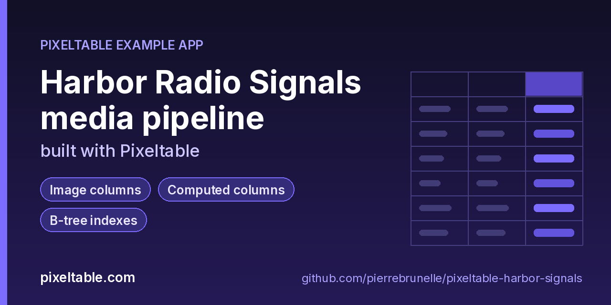

<!-- pixeltable-example-app: 20261011-harbor-signals -->
# Harbor Radio Signals media pipeline built with Pixeltable



[](https://codespaces.new/pierrebrunelle/pixeltable-harbor-signals?quickstart=1)
[](https://pixeltable.com)
[](https://pypi.org/project/pixeltable/)
[](https://github.com/pixeltable/pixeltable)
[](LICENSE)

A media pipeline for short harbor radio transmissions. Each signal carries a WAV clip, a cover still with predicted boxes, and a multi-sentence transcript. Pixeltable derives audio metadata, peak-normalized and faded copies, multiplies volume, draws annotated covers with vision helpers, and fans transcripts into a sentence view via StringSplitter. Small UDFs tag band lane, callsign, and duration bucket. Drive it with `python run.py` — no HTTP router.

[Pixeltable](https://pixeltable.com) is open-source, Python-native **multimodal AI data infrastructure**: tables, incremental computed columns, UDFs, indexes and serving in one library, running locally or on Pixeltable Cloud.

> ⭐ **Like this example?** Star [pixeltable/pixeltable](https://github.com/pixeltable/pixeltable) on GitHub. It helps other developers find it.

## What this example shows

- **Incremental computed columns** powered by plain Python UDFs (`@pxt.udf`)
- **B-tree indexes** declared on the model (`__indexes__`) back the lookup queries
- **Multimodal media columns** with configurable media destinations
- **Audio functions** from `pixeltable.functions.audio`
- **Vision functions** from `pixeltable.functions.vision`
- **Iterators**: one input row fans out into many (frames, chunks, sentences) via a view
- **Importable UDF module**: UDFs live in `udfs.py`; tables and queries live in `app.py` (Pixeltable resolves UDFs by module path)
- **`pixeltable.toml`** declares a local database and a **Pixeltable Cloud** database, so the same code deploys with `pxt db update`

## Audio transforms

`get_metadata` → `normalize` → `fade_in`/`fade_out` → `multiply_volume` on each clip.

## Vision overlays

`bboxes_draw` annotates the cover; `bboxes_pad` expands predicted boxes.

## StringSplitter view

`Sentences` is a component view over `Signals.transcript` (`separators='sentence'`).

## What's inside

| File | What it is |
|------|------------|
| `.devcontainer/devcontainer.json` | GitHub Codespaces / Dev Container config: Python 3.12, installs `requirements.txt` |
| `.github/social-preview.png` | Social preview image (1280x640) |
| `CITATION.cff` | Citation metadata (authors, license, release date, keywords) |
| `app.py` | Tables declared as Python classes and `@pxt.query` functions |
| `data/audio/alpha.wav` | Sample data |
| `data/audio/bravo.wav` | Sample data |
| `data/audio/charlie.wav` | Sample data |
| `data/images/alpha.png` | Sample data |
| `data/images/bravo.png` | Sample data |
| `data/images/charlie.png` | Sample data |
| `pixeltable.toml` | Project config: the local database plus a Pixeltable Cloud database (sizing, deploy excludes) |
| `run.py` | Harbor Signals media-pipeline driver (no HTTP service) |
| `seed.py` | Seed three sample harbor signals (uses files under data/) |
| `udfs.py` | Pixeltable UDFs (`@pxt.udf`) in their own importable module, imported by `app.py` |
| `requirements.txt` / `pyproject.toml` | Dependencies (`pixeltable>=0.7.16`) |

**Tables**

| Table | Stored columns | Computed columns |
|-------|---------|------------------|
| `signals` | `callsign`, `harbor`, `band`, `transcript`, `clip`, `cover`, `gt_boxes`, `pred_boxes`, `box_labels`, `duration_s` | `signal_id`, `meta`, `normalized`, `faded_in`, `faded`, `quiet`, `annotated`, `padded_pred`, `lane`, `tag`, `words`, `dur_bucket` |
| `sentences` | - | `length`, `upper` |

## Run in your browser (GitHub Codespaces)

[](https://codespaces.new/pierrebrunelle/pixeltable-harbor-signals?quickstart=1)

1. Click **Open in GitHub Codespaces** above (or [this link](https://codespaces.new/pierrebrunelle/pixeltable-harbor-signals?quickstart=1)). The dev container installs Python 3.12 and `pixeltable>=0.7.16` from `requirements.txt`.
2. In the codespace terminal, create the tables, seed them and run the app:

   ```bash
   pxt schema update app.py harbor
   pxt schema update app.py harbor
   python run.py
   ```


## Quickstart

Requires Python 3.11+ and `pixeltable>=0.7.16`.

```bash
git clone https://github.com/pierrebrunelle/pixeltable-harbor-signals.git
cd pixeltable-harbor-signals
python -m venv .venv && source .venv/bin/activate
pip install -r requirements.txt

# Create the tables in a local catalog directory named `harbor`
pxt schema update app.py harbor

pxt schema update app.py harbor
python run.py
```

## Deploy to Pixeltable Cloud

The same `app.py` runs on [Pixeltable Cloud](https://pixeltable.com). Sign in (or get a free trial database with `pxt new`), point the second database entry in `pixeltable.toml` at your own database, then deploy:

```bash
pxt login                       # or: export PIXELTABLE_API_KEY=<your-api-key>
# edit pixeltable.toml: name = 'pxt://<your-org>:<your-db>'
pxt db update pxt://<your-org>:<your-db>                 # build the image and upload the project
pxt schema update app.py pxt://<your-org>:<your-db>       # create the tables at the database root (no per-app folder)
```

Keep keys in environment variables or `pxt secret set`, never in code.

## Code walkthrough

**1. Business logic is plain Python, in `udfs.py`.** A `@pxt.udf` function can be used as a column expression. Pixeltable records UDFs by module path (`udfs.band_lane`), so they live in their own importable module rather than inline in the app: the daemon, serving workers and Pixeltable Cloud import it again by that path.

```python
# udfs.py
@pxt.udf
def band_lane(band: str) -> str:
    """Map radio band to an ops lane: vhf→near, mf→mid, hf→far, else unknown."""
    b = (band or '').strip().lower()
    return {'vhf': 'near', 'mf': 'mid', 'hf': 'far'}.get(b, 'unknown')
```

**2. Tables are Python classes (`app.py`).** Annotated attributes are stored columns; attributes assigned an expression are **computed columns** (`signal_id`, `meta`, `normalized`, `faded_in`, `faded`, `quiet`, `annotated`, `padded_pred`, `lane`, `tag`, `words`, `dur_bucket`), evaluated incrementally on every insert or update and recomputed when their inputs change. Indexes live next to the columns.

```python
# app.py
class Signals(TableModel, name='signals', has_default_idxs=False):
    """One harbor radio transmission: clip + cover still + transcript."""

    signal_id = pxt.Column(value=pxtf.uuid.uuid7(), primary_key=True)
    callsign: pxt.String
    harbor: pxt.String
    band: pxt.String  # vhf / mf / hf
    transcript: pxt.String
    clip: pxt.Audio
    cover: pxt.Image
    # ground-truth and predicted boxes on the cover (xyxy ints)
    gt_boxes: pxt.Json  # list[list[int]]
    pred_boxes: pxt.Json
    box_labels: pxt.Json  # list[str]

    # --- fn.audio primary ---
    meta = pxtf.audio.get_metadata(clip)
    normalized = pxtf.audio.normalize(clip)
    faded_in = pxtf.audio.fade_in(normalized, duration=0.25)
    faded = pxtf.audio.fade_out(faded_in, duration=0.25)
    quiet = pxtf.audio.multiply_volume(clip, factor=0.4)

    # duration from metadata (seconds); nested json path is best-effort
    duration_s: pxt.Float | None

    # --- fn.vision secondary ---
    annotated = pxtf.vision.bboxes_draw(
        cover,
        pred_boxes,
        labels=box_labels,
        color='lime',
        width=2,
    )
    padded_pred = pxtf.vision.bboxes_pad(pred_boxes, 'xyxy', x=4, y=4)

    # UDF chain
    lane = band_lane(band)
    tag = callsign_tag(callsign, harbor, band)
    words = transcript_word_count(transcript)
    dur_bucket = duration_bucket(duration_s)

    __indexes__ = [
        pxt.BtreeIndex(harbor),
        pxt.BtreeIndex(band),
        pxt.BtreeIndex(lane),
    ]
```

**3. Queries are functions (`app.py`).** `@pxt.query` wraps a Pixeltable query so it can be called from Python or exposed as a route:

```python
# app.py
@pxt.query
def by_harbor(harbor: str):
    """Signals for one harbor (harbor index)."""
    return (
        Signals.where(Signals.harbor == harbor)
        .select(
            Signals.signal_id,
            Signals.callsign,
            Signals.band,
            Signals.tag,
            Signals.lane,
            Signals.words,
            Signals.dur_bucket,
        )
        .order_by(Signals.callsign)
    )
```

## Learn more

- 🌐 Website: https://pixeltable.com
- 📚 Docs: https://docs.pixeltable.com
- 💻 Source: https://github.com/pixeltable/pixeltable (⭐ star it if Pixeltable is useful to you)
- 📦 PyPI: https://pypi.org/project/pixeltable/
- 🧩 More example apps: https://pierrebrunelle.github.io/awesome-pixeltable-apps/

**[More Pixeltable example apps →](https://pierrebrunelle.github.io/awesome-pixeltable-apps/)**

---

<sub>Built as part of a daily series of Pixeltable example apps · Pixeltable 0.7.16 · Python, incremental computed columns · Licensed under Apache-2.0.</sub>
